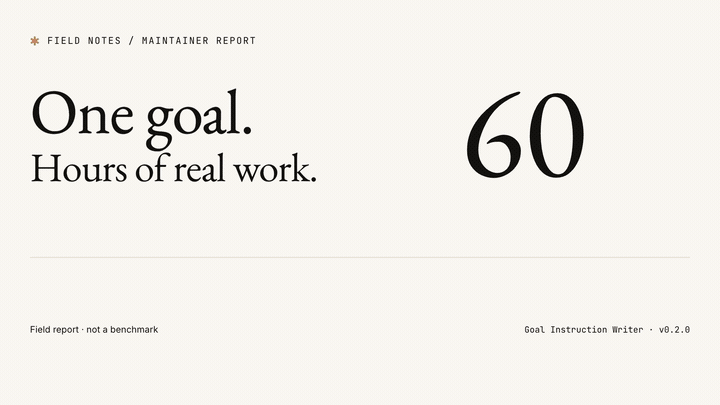

# Goal Instruction Writer

[English](README.md) · [简体中文](docs/README.zh-CN.md)

> **Keep a long agent workflow tied to one outcome.**
>
> Preview the loop. Make progress inspectable. Finish with evidence.

[Watch the full demo](https://github.com/wu736139669/goal-instruction-writer/releases/download/v0.2.0/goal-overview.mp4) · [English case studies](docs/cases/README.md) · [Real usage and evidence](docs/field-notes.md) · [Where to share a skill](docs/distribution.md)

AI agents rarely fail because they did too little. More often, they work for a long
time and quietly move away from the original outcome. <code>goal-instruction-writer</code>
turns “keep improving until it feels right” into a Goal instruction that can be
reviewed, bounded, paused, and finished cleanly.

It gives every long-running task an observable outcome, a bounded loop, evidence
for meaningful progress, drift gates, and explicit terminal states.

## Active work and waiting

The skill supports continuation after time or event triggers through its Goal
instructions. A single Goal can alternate between active iterations and waiting.
Its outcome and acceptance criteria stay the same; the next action depends on
what can usefully advance now.

| Situation | What the generated Goal tells the agent to do |
| --- | --- |
| An authorized work unit can advance a criterion | Inspect, act, verify, record evidence, then choose the next bounded work unit |
| A criterion depends on a later time or external response | Preserve the pending criterion, next check time or relevant notification, and deadline; continue independent work or yield with the checkpoint saved |
| The task is invoked again | Read the checkpoint and check limits; query the pending dependency only when its recorded time/event condition is met, then verify the response and continue |

This makes waiting a branch of the same Goal. A time or relevant notification
can permit another check. Waiting and a due observation of "still pending" do
not count as failed actionable attempts; actual queries, deadlines, and host
budgets still apply.

The skill defines what to save, when another check is allowed, and how to resume.
A host timer, relevant event, or authorized message can provide the next
invocation with access to the saved checkpoint. The host supplies persistence
and invocation, including any automatic delivery at the requested time. When
automatic wake-up is unavailable, a later authorized invocation can resume the
same workflow from its checkpoint.
The documented waiting branch has not yet been validated by a live wait/resume
test. See the [waiting rules](references/drift-control.md#scheduled-external-waits)
and [English example](docs/cases/open-source-feedback.md#how-the-waiting-branch-becomes-concrete).

## Built from long-running work

A concrete example is a multi-day **Factory Town Idle Godot port**. Project
records cover analysis and architecture on October 13, playable systems on
October 14, and a **0.49 local candidate with Mac and Android packages** on
October 17. The workflow carried forward production, construction, research,
cross-town effects, save/load behavior, and a durable next step. Read the
[case study and delivery timeline](docs/cases/factory-town-idle.md).

The maintainer estimates a longest game-development workflow at **more than
60 hours**. The inspected records establish multi-day work and concrete stage
deliveries; they do not measure uninterrupted agent compute time. At the case
snapshot, the full recreation Goal was still active. The agent, engine, asset
tools, and human decisions do the work; this skill supplies the instruction
contract that keeps it connected.

| Real work | What the Goal needs to preserve | Evidence available |
| --- | --- | --- |
| Game development | A playable result, coherent progression, runtime checks, and a build handoff across a long run | [Factory Town Idle: analysis → 0.49 local candidate](docs/cases/factory-town-idle.md), the maintainer's 60+ hour report, and separately identified [public game recordings](docs/field-notes.md#game-development) |
| Research and handoff | Source identities, rule coverage, tool limits, and explicit runtime gaps before implementation | A [source-led research archive](docs/cases/source-led-research.md) with 4,920 indexed methods; an earlier stage of the same game project |
| Android SDK delivery | Feature work, compatibility, integration, and artifact provenance with checks selected by change | An [SDK software handoff](docs/cases/android-sdk-delivery.md): 505 SDK tests per variant, eight artifact types, and 14 recorded Gradle calls totaling 9m 32s |
| Open-source collaboration | A reviewable submission, finite follow-up, external maintainer ownership, and accepted improvements | A [public contribution and feedback trace](docs/cases/open-source-feedback.md) through v0.2.3 and v0.2.4, alongside the earlier bounded evaluation |

The [case library](docs/cases/README.md) links each outcome to its evidence and
provides short contracts to adapt. It identifies private-record audits,
public contribution traces, and the limits of each recorded checkpoint.

## What changes when you use it

- **From a brief to a contract:** agree on the observable result, allowed scope,
  evidence, and stop conditions before a long run starts.
- **From repeated activity to a next step:** each iteration names one criterion,
  the expected change, and the next durable cursor.
- **From context loss to a checkpoint:** the Goal Anchor and decision record let
  a later turn or another agent recover the intended outcome.
- **From repeated release checks to valid evidence:** run focused checks while
  editing, complete required broader checks at the right gate, and reuse results
  whose relevant inputs still match.
- **From endless improvement to delivery:** finish when the criteria and
  deliverable are satisfied; surface blockers and limits explicitly.

Use it for game development, feature delivery, migrations, research, or launch
work that needs several iterations. A small one-shot task usually needs only a
normal prompt. It does not add execution permissions or keep a host running by
itself; continuation, tools, and context recovery come from your agent runtime.

## The idea in one picture

~~~mermaid
flowchart TD
    A["Vague request Keep improving until it feels right"] --> B{"Preview first?"}
    B -->|Long / costly / uncertain| C["Loop Preview States · branches · evidence · stops"]
    B -->|Short / reversible| D["Draft Goal"]
    C --> E{"User confirms the loop"}
    E -->|Revise| C
    E -->|Confirm| D
    D --> F["Goal Anchor Outcome · criteria · scope · authority"]
    F --> G["One iteration Inspect → Select → Act → Verify"]
    G --> H{"Alignment check"}
    H -->|ON_TARGET| I["Record evidence and cursor"]
    I --> J{"Criteria still open?"}
    J -->|Yes| G
    J -->|No| K["GOAL COMPLETE"]
    H -->|SIDE_QUEST| L["Defer with a revisit condition"]
    L --> G
    H -->|DRIFTED| M["Pause and realign"]
    M --> N["GOAL REALIGNMENT REQUIRED"]
    G --> O{"Blocked / budgeted / owner-stopped?"}
    O -->|Blocked| P["GOAL BLOCKED"]
    O -->|Budget exhausted| Q["GOAL TIMEBOXED"]
    O -->|Cancelled or beyond authority| R["GOAL STOPPED"]
~~~

## Why this exists

| Common failure | The contract adds |
| --- | --- |
| The goal is just “make it better” | An observable outcome and acceptance evidence |
| The loop is just “keep trying” | One smallest work unit and an expected delta per iteration |
| New discoveries silently change direction | A Goal Anchor that freezes outcome, criteria, scope, and authority |
| Useful side work consumes the main task | A <code>SIDE_QUEST</code> label and a deferred list |
| The agent keeps working without progress | Realignment after two equivalent actionable attempts add no progress or new relevant evidence |
| Small edits repeatedly trigger full validation and packaging | Focused iteration checks, required delivery gates, and reuse of valid evidence |
| An external dependency creates endless waiting | A next-check trigger and durable wait checkpoint; a named blocker when no resume trigger is supported |

## The three-layer contract

| Layer | Question | Reviewable proof |
| --- | --- | --- |
| **Goal** | What observable result should exist? | A file, behavior, decision, or verified fact |
| **Loop** | How does one iteration create progress? | Target criterion, expected delta, verification, and cursor |
| **Termination** | When must the work legally stop? | <code>COMPLETE</code>, <code>BLOCKED</code>, <code>PAUSED</code>, <code>TIMEBOXED</code>, or <code>STOPPED</code> |

Long-running work also gets a **Goal Anchor**:

~~~text
Goal Anchor: <one immutable outcome>
Success criteria: C1 <...>; C2 <...>; C3 <...>
Frozen scope: <invariants and forbidden side effects>
Allowed authority: <tools, files, systems, and approvals>
Current phase: <phase or milestone>
~~~

For feedback, adoption, pilot, launch, or validation Goals, define what counts
as evidence before execution: an entry point, at least <code>N</code> non-author
responses, or a named cohort. Add the feedback window and do not count
author-only activity unless the Goal explicitly chooses it.

Goals also define a **verification strategy**: use focused checks during edits,
complete required broader checks when the implementation is stable, and tie
results to their relevant inputs and artifacts. Rerun checks when changes or
new evidence invalidate them; report-only commits can reuse unrelated runtime
results. Expensive checks get suitable bounds, and timed-out criteria stay
open. Explicit acceptance and release requirements still apply.

## Drift control in one picture

~~~mermaid
flowchart LR
    A["Goal Anchor"] --> B["Iteration record criterion · expected delta · scope reason"]
    B --> C["Act and verify"]
    C --> D{"Alignment"}
    D -->|ON_TARGET| E["Keep evidence choose the next cursor"]
    E --> B
    D -->|SIDE_QUEST| F["Defer add a revisit condition"]
    F --> B
    D -->|DRIFTED| G["Pause preserve the checkpoint"]
    G --> H["Re-anchor after an owner decision"]
    H --> B
~~~

Activity is not progress. An iteration counts only when it advances a named
criterion and leaves evidence another agent can inspect.

## Install

### Recommended: open agent skills CLI

~~~bash
npx skills add wu736139669/goal-instruction-writer \
  --skill goal-instruction-writer -g -a codex -y
~~~

The command is verified against this repository and detects one skill:
<code>goal-instruction-writer</code>.

### Git clone fallback

~~~bash
SKILL_ROOT="${CODEX_HOME:-$HOME/.codex}"
git clone https://github.com/wu736139669/goal-instruction-writer.git \
  "$SKILL_ROOT/skills/goal-instruction-writer"
~~~

After installation, invoke it explicitly as <code>$goal-instruction-writer</code>, or
let Codex discover it automatically for Goal-shaped requests.

## 30-second usage

### 1. Preview a long or uncertain task

~~~text
Use $goal-instruction-writer in Preview mode.
Do not execute yet. Show the objective, loop steps, success and failure branches,
evidence, drift checks, and terminal conditions.
~~~

The preview should expose the loop before any external side effect:

~~~text
Inspect baseline → choose one criterion → make one bounded change
→ verify evidence → classify ON_TARGET / SIDE_QUEST / DRIFTED
→ continue, defer, block, or realign
~~~

### 2. Confirm the loop

~~~text
The loop is confirmed. Keep the current scope and terminal rules, then generate
the final Goal instruction.
~~~

### 3. Use the Goal during execution

~~~text
Before each iteration, state the target criterion, expected evidence, and scope reason.
After each iteration, state the actual evidence, alignment label, remaining gap,
and next cursor.
For an external wait, save the pending criterion, next check time/event, and deadline.
Before the trigger, continue independent work or yield without another lookup.
On a later invocation, read the checkpoint and check limits before querying.
Waiting and due observations of "still pending" are not failed actionable attempts.
If two equivalent actionable attempts add neither acceptance progress nor new
relevant evidence, stop with:
GOAL REALIGNMENT REQUIRED.
~~~

For a short, reversible task, skip Preview and ask directly:

~~~text
Use $goal-instruction-writer to draft the final Goal for this task.
~~~

## Modes

| Mode | Use it when | Output |
| --- | --- | --- |
| **Preview** | You want to inspect the loop, branches, and stops first | A reviewable flow; no executable Goal yet |
| **Draft** | You have a rough request | A complete, ready-to-paste Goal |
| **Refine** | An existing Goal is missing fields or boundaries | A minimal revision that preserves intent |
| **Audit** | You suspect drift, repetition, or unauthorized transitions | Findings and the smallest fixes |
| **Convert** | You have a ticket, checklist, or project brief | A Goal without silent scope expansion |

## A small before/after

**Weak request**

~~~text
Fix the importer and keep trying until it works.
~~~

**Reviewable Goal**

~~~text
Objective: make fixtures/quoted_multiline.csv load into the existing record model
without truncation or row-count drift.

Loop: inspect the current failure → choose one parsing hypothesis → make one
focused change → run the focused test → record the diff and result → choose the
next unmet criterion.

Drift control: bind every iteration to one criterion, expected evidence, and
scope reason; put unrelated cleanup in the deferred list.

Termination: emit GOAL COMPLETE when all criteria pass; emit
GOAL BLOCKED: <reason> after two equivalent failures; emit
GOAL TIMEBOXED: <state> after the four-iteration limit.
~~~

## Try it on a game-development task

~~~text
Use $goal-instruction-writer to preview a Goal for a playable Godot game slice.
First show the outcome, scope, one iteration, evidence, and stop conditions.
Include a playable core loop, one coherent progression path, runtime playtest
evidence, save/load behavior, and a reproducible build handoff.
Keep the game concept and platform fixed. Park unrelated features.
Use focused checks during edits and the required broader checks at delivery.
Preserve the Goal Anchor and the next cursor across turns.
Do not execute the development task until I confirm the loop and ask you to run it.
~~~

After confirming the preview, ask for the ready-to-paste Goal, then run it in
your agent's supported long-running workflow. A Goal is an instruction contract;
the exact start, resume, and status commands depend on that host.

## Runtime boundary

The skill designs and audits the instruction contract. Runtime access,
permissions, tool availability, and approval for external side effects remain
controlled by the host agent and the user.

For external gates, preserve the open criterion, evidence, next check time/event,
and deadline or unblock condition. Continue independent work or yield until the
trigger; waiting does not consume the actionable no-progress allowance. Actual
queries and elapsed time still count toward host limits. See the
[scheduled-wait rules](references/drift-control.md#scheduled-external-waits).

## Resources

- [Skill entrypoint](SKILL.md)
- [Goal contract and ready-to-paste skeleton](references/goal-contract.md)
- [Loop preview format and flow diagram](references/loop-preview.md)
- [Drift detection and recovery](references/drift-control.md)
- [Coding, research, and open-source examples](references/examples.md)
- [Launch kit with ready-to-post copy](docs/launch-kit.md)
- [Independent Goal evaluation](docs/evaluations/2026-10-11-independent-goal-evaluation.md)
- [Real usage, recorded examples, and evidence limits](docs/field-notes.md)
- [Factory Town Idle: a multi-day Goal case study](docs/cases/factory-town-idle.md)
- [Skill distribution and submission guide](docs/distribution.md)
- [Editable video source and provenance](videos/goal-overview/BRIEF.md)
- [Contributing guide](CONTRIBUTING.md)
- [GitHub Discussions](https://github.com/wu736139669/goal-instruction-writer/discussions)
- [Chinese documentation](docs/README.zh-CN.md)

## Contributing

Have a real use case, a confusing preview, or a better drift rule? Open a
[Discussion](https://github.com/wu736139669/goal-instruction-writer/discussions)
for a workflow question, or open an issue for a focused change. Small pull
requests are welcome when they preserve the three-layer contract and include a
clear reason or example.

Before opening a pull request, run:

~~~bash
npx --yes skills add . --list
~~~

The same packaging check runs automatically in GitHub Actions.

## License

MIT. See [LICENSE](LICENSE).
