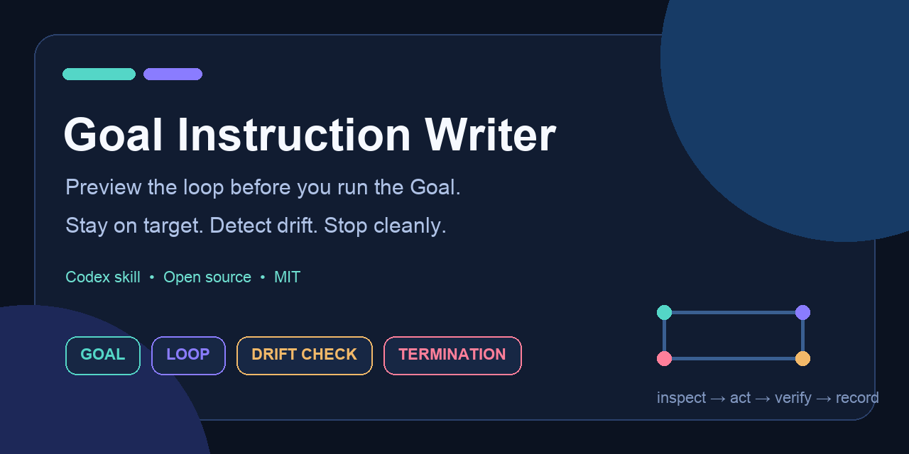

# Goal Instruction Writer

[English](README.md) · [简体中文](docs/README.zh-CN.md)

> **Write the Goal after you can explain the loop.**
>
> **Preview the loop before an agent starts.**

AI agents rarely fail because they did too little. More often, they work for a long
time and quietly move away from the original outcome. <code>goal-instruction-writer</code>
turns “keep improving until it feels right” into a Goal instruction that can be
reviewed, bounded, paused, and finished cleanly.

It gives every long-running task an observable outcome, a bounded loop, evidence
for meaningful progress, drift gates, and explicit terminal states.

## The idea in one picture

~~~mermaid
flowchart TD
    A["Vague request Keep improving until it feels right"] --> B{"Preview first?"}
    B -->|Long / costly / uncertain| C["Loop Preview States · branches · evidence · stops"]
    B -->|Short / reversible| D["Draft Goal"]
    C --> E{"User confirms the loop"}
    E -->|Revise| C
    E -->|Confirm| D
    D --> F["Goal Anchor Outcome · criteria · scope · authority"]
    F --> G["One iteration Inspect → Select → Act → Verify"]
    G --> H{"Alignment check"}
    H -->|ON_TARGET| I["Record evidence and cursor"]
    I --> J{"Criteria still open?"}
    J -->|Yes| G
    J -->|No| K["GOAL COMPLETE"]
    H -->|SIDE_QUEST| L["Defer with a revisit condition"]
    L --> G
    H -->|DRIFTED| M["Pause and realign"]
    M --> N["GOAL PAUSED: realignment required"]
    G --> O{"Blocked / budgeted / owner-stopped?"}
    O -->|Blocked| P["GOAL BLOCKED"]
    O -->|Budget exhausted| Q["GOAL TIMEBOXED"]
    O -->|Cancelled or beyond authority| R["GOAL STOPPED"]
~~~

## Why this exists

| Common failure | The contract adds |
| --- | --- |
| The goal is just “make it better” | An observable outcome and acceptance evidence |
| The loop is just “keep trying” | One smallest work unit and an expected delta per iteration |
| New discoveries silently change direction | A Goal Anchor that freezes outcome, criteria, scope, and authority |
| Useful side work consumes the main task | A <code>SIDE_QUEST</code> label and a deferred list |
| The agent keeps working without progress | A pause after two materially equivalent no-progress iterations |
| An external dependency creates endless waiting | <code>GOAL BLOCKED</code> with the exact unblock needed |

## The three-layer contract

| Layer | Question | Reviewable proof |
| --- | --- | --- |
| **Goal** | What observable result should exist? | A file, behavior, decision, or verified fact |
| **Loop** | How does one iteration create progress? | Target criterion, expected delta, verification, and cursor |
| **Termination** | When must the work legally stop? | <code>COMPLETE</code>, <code>BLOCKED</code>, <code>PAUSED</code>, <code>TIMEBOXED</code>, or <code>STOPPED</code> |

Long-running work also gets a **Goal Anchor**:

~~~text
Goal Anchor: <one immutable outcome>
Success criteria: C1 <...>; C2 <...>; C3 <...>
Frozen scope: <invariants and forbidden side effects>
Allowed authority: <tools, files, systems, and approvals>
Current phase: <phase or milestone>
~~~

## Drift control in one picture

~~~mermaid
flowchart LR
    A["Goal Anchor"] --> B["Iteration record criterion · expected delta · scope reason"]
    B --> C["Act and verify"]
    C --> D{"Alignment"}
    D -->|ON_TARGET| E["Keep evidence choose the next cursor"]
    E --> B
    D -->|SIDE_QUEST| F["Defer add a revisit condition"]
    F --> B
    D -->|DRIFTED| G["Pause preserve the checkpoint"]
    G --> H["Re-anchor after an owner decision"]
    H --> B
~~~

Activity is not progress. An iteration counts only when it advances a named
criterion and leaves evidence another agent can inspect.

## Install

### Recommended: open agent skills CLI

~~~bash
npx skills add wu736139669/goal-instruction-writer \
  --skill goal-instruction-writer -g -a codex -y
~~~

The command is verified against this repository and detects one skill:
<code>goal-instruction-writer</code>.

### Git clone fallback

~~~bash
SKILL_ROOT="${CODEX_HOME:-$HOME/.codex}"
git clone https://github.com/wu736139669/goal-instruction-writer.git \
  "$SKILL_ROOT/skills/goal-instruction-writer"
~~~

After installation, invoke it explicitly as <code>$goal-instruction-writer</code>, or
let Codex discover it automatically for Goal-shaped requests.

## 30-second usage

### 1. Preview a long or uncertain task

~~~text
Use $goal-instruction-writer in Preview mode.
Do not execute yet. Show the objective, loop steps, success and failure branches,
evidence, drift checks, and terminal conditions.
~~~

The preview should expose the loop before any external side effect:

~~~text
Inspect baseline → choose one criterion → make one bounded change
→ verify evidence → classify ON_TARGET / SIDE_QUEST / DRIFTED
→ continue, defer, block, or realign
~~~

### 2. Confirm the loop

~~~text
The loop is confirmed. Keep the current scope and terminal rules, then generate
the final Goal instruction.
~~~

### 3. Use the Goal during execution

~~~text
Before each iteration, state the target criterion, expected evidence, and scope reason.
After each iteration, state the actual evidence, alignment label, remaining gap,
and next cursor.
If two equivalent iterations produce no new progress, stop with:
GOAL PAUSED: realignment required.
~~~

For a short, reversible task, skip Preview and ask directly:

~~~text
Use $goal-instruction-writer to draft the final Goal for this task.
~~~

## Modes

| Mode | Use it when | Output |
| --- | --- | --- |
| **Preview** | You want to inspect the loop, branches, and stops first | A reviewable flow; no executable Goal yet |
| **Draft** | You have a rough request | A complete, ready-to-paste Goal |
| **Refine** | An existing Goal is missing fields or boundaries | A minimal revision that preserves intent |
| **Audit** | You suspect drift, repetition, or unauthorized transitions | Findings and the smallest fixes |
| **Convert** | You have a ticket, checklist, or project brief | A Goal without silent scope expansion |

## A small before/after

**Weak request**

~~~text
Fix the importer and keep trying until it works.
~~~

**Reviewable Goal**

~~~text
Objective: make fixtures/quoted_multiline.csv load into the existing record model
without truncation or row-count drift.

Loop: inspect the current failure → choose one parsing hypothesis → make one
focused change → run the focused test → record the diff and result → choose the
next unmet criterion.

Drift control: bind every iteration to one criterion, expected evidence, and
scope reason; put unrelated cleanup in the deferred list.

Termination: emit GOAL COMPLETE when all criteria pass; emit
GOAL BLOCKED: <reason> after two equivalent failures; emit
GOAL TIMEBOXED: <state> after the four-iteration limit.
~~~

## Runtime boundary

The skill designs and audits the instruction contract. Runtime access,
permissions, tool availability, and approval for external side effects remain
controlled by the host agent and the user.

For external gates, preserve the evidence and stop with the exact unblock needed.
Waiting for a maintainer, owner, or missing dataset is not a reason to invent more work.

## Resources

- [Skill entrypoint](SKILL.md)
- [Goal contract and ready-to-paste skeleton](references/goal-contract.md)
- [Loop preview format and flow diagram](references/loop-preview.md)
- [Drift detection and recovery](references/drift-control.md)
- [Coding, research, and open-source examples](references/examples.md)
- [Launch kit with ready-to-post copy](docs/launch-kit.md)
- [Contributing guide](CONTRIBUTING.md)
- [GitHub Discussions](https://github.com/wu736139669/goal-instruction-writer/discussions)
- [Chinese documentation](docs/README.zh-CN.md)

## Contributing

Have a real use case, a confusing preview, or a better drift rule? Open a
[Discussion](https://github.com/wu736139669/goal-instruction-writer/discussions)
for a workflow question, or open an issue for a focused change. Small pull
requests are welcome when they preserve the three-layer contract and include a
clear reason or example.

Before opening a pull request, run:

~~~bash
npx --yes skills add . --list
~~~

The same packaging check runs automatically in GitHub Actions.

## License

MIT. See [LICENSE](LICENSE).
