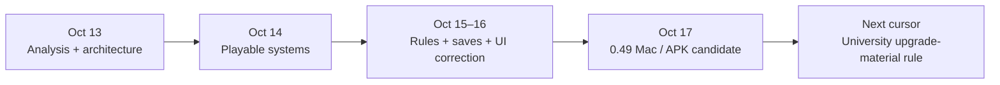

# A multi-day Goal: Factory Town Idle in Godot

[Evidence summary](factory-town-idle-evidence.json) ·
[Field notes](../field-notes.md)

Recorded on October 17, 2026, at the 0.49r1 local candidate checkpoint.

The maintainer supplied a real development session after describing a longest
game-development workflow of more than 60 hours. The inspected project is a
**Factory Town Idle Godot development study**. Its records show analysis,
architecture, playable systems, interface corrections, save/load work, and
versioned Mac and Android candidates across several days.

The useful result is a chain of inspectable deliveries with a recoverable next
step. At this checkpoint, the complete recreation Goal was still active.

## From analysis to a playable candidate

| Date | Recorded work | What survives into the next stage |
| --- | --- | --- |
| Oct 13 | Source analysis and a Godot/mobile architecture plan | Gameplay rules, module boundaries, asset identities, save/time behavior, and future acceptance criteria |
| Oct 14 | Playable production, research, trading, regional progression, and water/power systems | Independent examples, actual state changes, saved progress, and explicit remaining gaps |
| Oct 15 | The inspected Git history begins with an already-verified 0.19 baseline; construction, progression, storage, and recovery work continue | Versioned source, archived builds, preserved player data, and current evidence |
| Oct 16 | Further system work and a user-directed main-screen correction, followed by renewed development | Accepted direction, updated scope decisions, and a persistent criterion/cursor record |
| Oct 17 | 0.48 research-screen and 0.49 monastery candidates delivered locally with matching Mac/APK source | A playable entry, current behavior evidence, save/continue checks, and the next original-rule audit |

This is a checkpoint timeline, not a graph of continuous agent activity. The
inspected branch contains 115 commits from October 15 at 01:27:41 to October
17 at 10:27:35 (UTC+08:00), about 57 elapsed hours. That history starts at
version 0.19 and omits earlier development. Neither it nor the document dates
measure total active compute time. The **60+ hour** figure remains the
maintainer's estimate; no exact unattended-duration claim is made.

## What was actually delivered at 0.49

The bounded feature was a paid monastery whose completed count changes
research-material costs across towns. Construction, cancellation, removal,
cross-town effects, and save/continue behavior had explicit checks. It was
delivered as a local candidate with an ordinary entry, a separate advanced
example, a viewer, and matching-source Mac and Android packages.

The inspected package report records:

- **358** current compiled numerical comparisons against the reference methods.
- **101** current compiled behavior and scene checks, plus **146** focused
  source regressions; these are separate check categories.
- A **28.84-second** runtime recording of remaining construction completing,
  research inputs changing, completion/claim, and saving.
- **18 existing player files** unchanged in the final protection audit.

The advanced example supplies level, prerequisite, facility, and material
state. Before recording, construction is explicitly advanced by a 35,992-second
model step so its remaining completion fits the clip; the recording itself
runs at normal 1× speed. A separate ordinary fresh-start flow checks early
play without those grants. The clip does not show reaching the advanced state
from a new game or ten hours of real-time construction.

At this snapshot, the candidate had not been promoted as a formal release;
full-game recreation, human acceptance, and physical-phone checks remained
open or separately assigned. The next cursor named the original university
upgrade-material rule audit. A finished feature candidate did not silently
become a finished game.

## How the contract helps the work continue

The local execution contract links each work unit to a criterion, expected
change, scope reason, evidence, and next cursor. It preserves the game's
economic and save semantics while allowing an explicit user decision to
change interface priorities. A later iteration can recover both the original
outcome and the next concrete action.

The verification record shows why “run fewer tests” is too coarse a rule:

| Change | Recorded verification decision |
| --- | --- |
| 0.48 research-screen revision with matching core and fixture inputs | Reuse 1,983 exact numerical comparisons; run 74 current compiled behavior and scene checks |
| 0.49 changes the shared research-material rule | Do not use the old 0.48 comparisons as proof of the changed core; record current reference comparisons and affected behavior checks |

This is the behavior the skill's [verification strategy](../../SKILL.md#verification-strategy)
is designed to express: preserve valid evidence, refresh affected evidence,
and keep the required delivery gate. The audit does not establish a causal
speedup or measure time saved by this skill version.

## Evidence and media

This case is a maintainer audit of private project records, not a public
reproduction benchmark. The accompanying [JSON summary](factory-town-idle-evidence.json)
contains the inspected revision identities, artifact hashes, counts, and
document fingerprints. Hashes identify the audited inputs; they do not make
the underlying private records independently accessible.

The public case publishes the timeline and audit summary. The research build,
its reference materials, and its raw runtime media remain private. The
repository's existing demonstration uses separately labeled, already-public
**Moonlit Kingdom** gameplay. It is a different project, not footage or a
time-lapse of this case.
